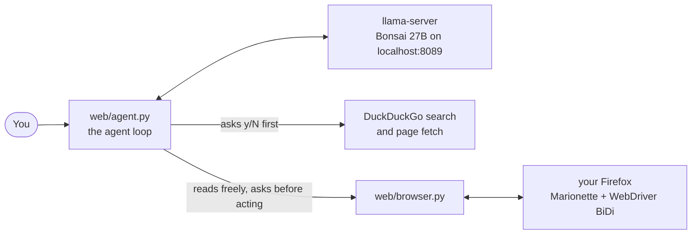

# Bonsai: a 27B model on my own GPU, with a web and browser agent

I run PrismML's **Ternary Bonsai 2 27B** on my own PC. Its weights are ternary, about 2 bits each, so a 27-billion-parameter model comes out at about 7 GB and fits on a consumer graphics card. On top of it I built a small terminal agent. It can search the web, read pages, and drive my real Firefox window, and it asks me before it does anything that changes a page.

This repo is just my scripts. The model and PrismML's build of llama.cpp aren't included (see [What you need](#what-you-need)).

**Jump to:** [Quick start](#quick-start) · [How it works](#how-it-works) · [What's in here](#whats-in-here) · [What you need](#what-you-need) · [Things I learned](#things-i-learned) · [Credit](#credit)

## Quick start

```bash
# 1. Put the scripts on your PATH (and bonsai-long, which is the same script)
ln -s "$PWD/bonsai" "$PWD/bonsai-web" "$PWD/firefox-bonsai" ~/.local/bin/
ln -s "$PWD/bonsai" ~/.local/bin/bonsai-long

# 2. Chat in the terminal (16K context, all on the GPU)
bonsai

# 3. Or the agent with web search and Firefox control
firefox-bonsai      # Firefox with remote control on (localhost only)
bonsai-web
```

The model is the `.gguf` file next to the scripts. To keep it somewhere else, point `BONSAI_MODEL` at it:

```bash
BONSAI_MODEL=~/models/my-bonsai.gguf bonsai
```

## How it works



<details>
<summary><b>Follow one question from start to finish</b> (click to open)</summary>

1. You ask something. If the message has links in it, the pages get fetched first, so the model reads them instead of searching for them.
2. The model answers, or calls a tool. It gets one web search per question, so it has to make it count.
3. **Reading is free; acting asks first.** Searching, fetching, and anything that changes a page (open, click, type, select) waits for `y/N`. In the browser you can answer `a` to allow actions for the rest of that question.
4. Text on web pages is treated as data, never as instructions. The system prompt says so, because a page can try to talk to the model.
5. Only the newest page snapshot stays in the context. Older ones get trimmed so a long browsing session doesn't fill it up.

</details>

<details>
<summary><b>What the agent can do in Firefox</b> (click to open)</summary>

| Tool | Asks first? | What it does |
|---|---|---|
| `browser_tabs` | no | Lists your open tabs |
| `browser_read` | no | Reads the page as text, with every link, button and field numbered `[n]` |
| `browser_scroll` | no | Scrolls, then reads again |
| `browser_switch_tab` | no | Switches tab, then reads it |
| `browser_open` | yes | Opens a URL (current tab or a new one) |
| `browser_click` | yes | Clicks `[n]` with a real mouse event |
| `browser_type` | yes | Types into field `[n]`, and can press Enter |
| `browser_select` | yes | Picks an option in dropdown `[n]` |
| `browser_back` | yes | Goes back |

</details>

## What's in here

| File | What it does |
|---|---|
| `bonsai` | Chat with the model in the terminal. Everything stays on the GPU with a 16K context. Called as `bonsai-long`, it gives a 128K context with the KV cache in system RAM. |
| `bonsai-web` | Starts `llama-server` with tool calling (`--jinja`) on `127.0.0.1:8089`, waits until the model is loaded, then opens the agent. |
| `firefox-bonsai` | Starts Firefox with remote control on, reachable only from this machine. |
| `web/agent.py` | The agent loop: a web search (DuckDuckGo), fetching pages, and the browser tools. |
| `web/browser.py` | Drives Firefox over Marionette and WebDriver BiDi: reads the page as text with numbered elements, then clicks and types with real input events. |

## What you need

- An NVIDIA GPU. I run it on 8 to 12 GB cards.
- PrismML's llama.cpp fork, built with CUDA. The scripts expect it in `llama-prism/` next to them.
- The Ternary Bonsai 2 27B GGUF from PrismML, next to the scripts (or set `BONSAI_MODEL`).
- [uv](https://docs.astral.sh/uv/) to run the agent (it installs its own Python packages), and Firefox.

<details>
<summary><b>Troubleshooting</b> (click to open)</summary>

- **"No model found"**: put the `.gguf` next to the scripts, or set `BONSAI_MODEL`.
- **"bonsai-web is already running in another terminal"**: one server at a time, since the GPU only fits one copy of the model. Use that terminal, or `/exit` it first.
- **"Firefox control: OFF"**: your Firefox was started normally. Quit it (Ctrl+Q) and start it with `firefox-bonsai`. Your tabs come back if session restore is on.
- **The chat errors after a long session**: the context is probably full. Type `/clear`.

</details>

## Things I learned

<details>
<summary><b>Context costs memory</b></summary>

Every token in the context keeps its keys and values in every layer. On 8 GB, a 16K context only fits on the GPU with the KV cache quantised to `q4_0`; at `q8_0` only 8K fits. For 128K I moved the cache to system RAM (`-nkvo`), which is slower but works.

</details>

<details>
<summary><b>Reading a prompt is much faster than writing an answer</b></summary>

The prompt goes through in parallel batches, but the answer comes out one token at a time, so I always look at the two speeds separately.

</details>

<details>
<summary><b>Browser sessions can get stuck</b></summary>

A WebDriver BiDi session made with `session.new` outlives its client and blocks new ones until Firefox restarts. Opening the session over Marionette ties it to that socket, so Firefox ends it when the agent exits, even after a crash.

</details>

## Credit

The model and the llama.cpp fork are PrismML's, and llama.cpp is ggml-org's. I designed and built the launchers and the agent, AI-assisted. MIT licensed (see [LICENSE](LICENSE)).
